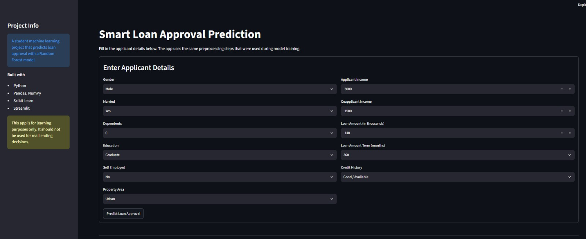
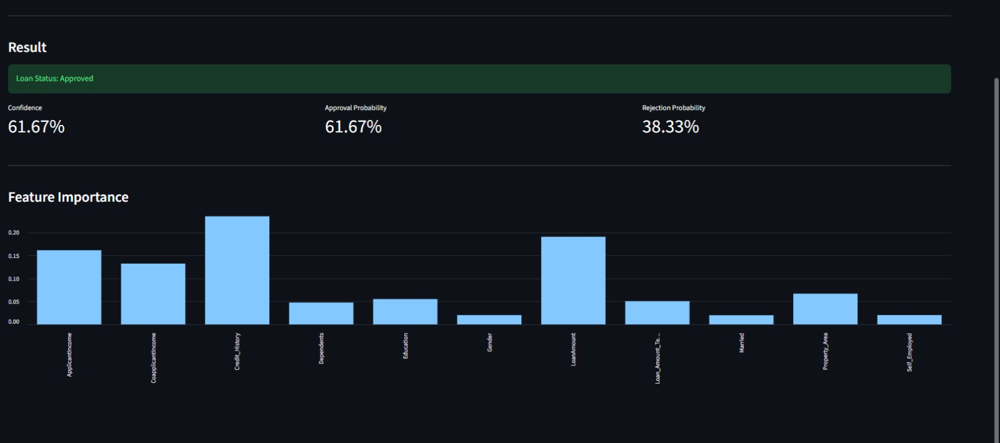

# Smart Loan Approval Prediction using Machine Learning

Smart Loan Approval Prediction is a machine learning web application that
predicts whether a loan application is likely to be approved. The project uses a
Kaggle Loan Prediction Dataset-style CSV file, trains a Random Forest classifier,
and serves predictions through a Streamlit interface.

This project is prepared as a student internship submission and focuses on clean
Python code, understandable preprocessing, reproducible training, and a simple
frontend that demonstrates the model clearly.

## Project Highlights

- End-to-end machine learning workflow in Python
- Realistic loan approval dataset with 1,000 records
- Missing value handling for categorical and numerical fields
- Label encoding for categorical variables
- Feature scaling for numerical variables
- Train/test split before fitting preprocessing objects
- RandomForestClassifier model from Scikit-learn
- Model evaluation using accuracy, precision, recall, F1 score, and confusion matrix
- Saved model and preprocessing artifacts using joblib
- Streamlit app for interactive loan approval prediction
- Feature importance chart for basic model interpretability

## Technology Stack

| Area | Tools |
| --- | --- |
| Language | Python |
| Data Handling | Pandas, NumPy |
| Machine Learning | Scikit-learn |
| Model Persistence | joblib |
| Frontend | Streamlit |

## Folder Structure

```text
SmartLoanPrediction/
|-- app.py
|-- train_model.py
|-- predict.py
|-- requirements.txt
|-- README.md
|-- .gitignore
|-- data/
|   |-- loan.csv
|-- model/
|   |-- model.joblib
|   |-- encoder.joblib
|   |-- scaler.joblib
|   |-- target_encoder.joblib
|-- utils/
|   |-- preprocessing.py
```

## Dataset Columns

The dataset is stored at `data/loan.csv` and follows the common Kaggle Loan
Prediction Dataset format.

| Column | Description |
| --- | --- |
| Loan_ID | Unique loan application ID |
| Gender | Applicant gender |
| Married | Marital status |
| Dependents | Number of dependents |
| Education | Education level |
| Self_Employed | Whether the applicant is self-employed |
| ApplicantIncome | Applicant monthly income |
| CoapplicantIncome | Co-applicant monthly income |
| LoanAmount | Loan amount in thousands |
| Loan_Amount_Term | Loan repayment term in months |
| Credit_History | Credit history availability/status |
| Property_Area | Urban, Semiurban, or Rural |
| Loan_Status | Target variable: Y for approved, N for rejected |

## Setup Instructions

Clone or download the project, then open a terminal inside the project folder.

Create a virtual environment:

```bash
python -m venv venv
```

Activate the virtual environment on Windows:

```bash
venv\Scripts\activate
```

Install dependencies:

```bash
pip install -r requirements.txt
```

## Train the Model

Run:

```bash
python train_model.py
```

The script will:

1. Load `data/loan.csv`
2. Validate required columns
3. Split the data into training and testing sets
4. Fit preprocessing only on the training data
5. Train a Random Forest classifier
6. Print evaluation metrics
7. Save model artifacts inside the `model/` folder

Expected saved files:

- `model/model.joblib`
- `model/encoder.joblib`
- `model/scaler.joblib`
- `model/target_encoder.joblib`

## Run the Streamlit App

Run:

```bash
streamlit run app.py
```

Then open the local URL shown in the terminal. Enter applicant details and click
**Predict Loan Approval**.

## Screenshots

Add screenshots after running the app locally.

### Home Page



### Prediction Result



## Model Notes

The project uses `RandomForestClassifier` because it works well for tabular
classification problems and provides feature importance values. The model is not
intended for real financial decision-making. In a real lending environment, the
system would need fairness checks, regulatory review, stronger validation,
monitoring, and explainability.

## How to Test

Run these commands before submission:

```bash
python train_model.py
python predict.py
streamlit run app.py
```

If all commands run successfully, the project is ready for demonstration.
